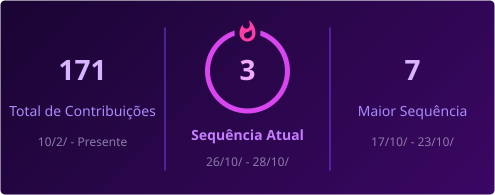

<div align="center">
  
</div>

<div align="center">
  
</div>

<p align="center">
  
  &nbsp;
  <a href="mailto:arthurstelzner@gmail.com"></a>
</p>

---

## Habilidades & Stack

<p align="center"><em>As tecnologias que eu uso no dia a dia para construir soluções web eficientes.</em></p>

<h3 align="center">Back-end & Linguagens</h3>

<p align="center">
  
  &nbsp;
  
  &nbsp;
  
</p>

<p align="center">
  
  &nbsp;
  
  &nbsp;
  
  &nbsp;
  
</p>

<h3 align="center">Banco de Dados & Ferramentas</h3>

<p align="center">
  
  &nbsp;
  
  &nbsp;
  
</p>

<h3 align="center">Front-end</h3>

<p align="center">
  
  &nbsp;
  
</p>

<h3 align="center">Cursos &amp; Certificações</h3>

<p align="center"><em>Cibersegurança — Cisco Networking Academy</em></p>

<p align="center">
  
  <br/>
  
  <br/>
  
</p>

---

## Sobre mim

> **Desenvolvedor Back End | PHP • Python • Node.js • JavaScript • Docker • MySQL**
> Apaixonado por tecnologia e pela construção de soluções web eficientes.

Sou desenvolvedor back end e meu dia a dia é transformar ideias em aplicações web que funcionam de verdade. Trabalho principalmente com **PHP**, **Python** e **Node.js**, criando APIs, automações e aplicações escaláveis — sempre com **Docker** para garantir ambientes consistentes e **MySQL** para manter os dados bem estruturados. Também atuo no front-end com **HTML5**, **CSS3** e **JavaScript/TypeScript** quando o projeto pede.

Apaixonado por tecnologia, estou sempre buscando aprender mais, escrever código limpo e construir soluções que realmente façam a diferença.

```javascript
const arthur = {
  papel: "Desenvolvedor Back End",
  stack: ["PHP", "Python", "Node.js", "JavaScript", "TypeScript"],
  bancoDeDados: ["MySQL"],
  ferramentas: ["Docker", "Git", "HTML5", "CSS3"],
  tambemProgramoEm: ["C", "C++"],
  paixao: "tecnologia e soluções web eficientes"
};
```

- Atuo no desenvolvimento back end, criando APIs e aplicações web com PHP, Python e Node.js
- Aprofundando meus conhecimentos em TypeScript, Docker e arquitetura de software
- Me pergunte sobre PHP, Python, Node.js, MySQL, Docker e Git
- Curiosidade: também programo em C e C++ e gosto de entender como as coisas funcionam por baixo

---

## Estatísticas do GitHub

<p align="center">
  
  
</p>

<p align="center">
  
</p>

<p align="center">
  
</p>

---

## Calendário de contribuições

<p align="center">
  <picture>
    <source media="(prefers-color-scheme: dark)" srcset="https://raw.githubusercontent.com/ThurStelZner/ThurStelZner/output-3d-contrib/night.svg" />
    <source media="(prefers-color-scheme: light)" srcset="https://raw.githubusercontent.com/ThurStelZner/ThurStelZner/output-3d-contrib/day.svg" />
    
  </picture>
</p>

---

## Contribuições em movimento

<p align="center">
  <picture>
    <source media="(prefers-color-scheme: dark)" srcset="https://raw.githubusercontent.com/ThurStelZner/ThurStelZner/output/github-contribution-grid-snake-dark.svg" />
    <source media="(prefers-color-scheme: light)" srcset="https://raw.githubusercontent.com/ThurStelZner/ThurStelZner/output/github-contribution-grid-snake.svg" />
    
  </picture>
</p>

---

## Vamos conversar?

<p align="center"><em>Aberto a conversas sobre tecnologia, back end, open source e novas ideias.</em></p>

<p align="center">
  <a href="http://br.linkedin.com/in/arthur-iantas-stelzner-867a392b5"></a>
  &nbsp;
  <a href="https://instagram.com/_.thurst._"></a>
  &nbsp;
  <a href="https://thurstelzner.github.io/MeuPortfolio/"></a>
  &nbsp;
  
  &nbsp;
  <a href="https://github.com/ThurStelZner"></a>
</p>

<br/>

<p align="center">
  
</p>
